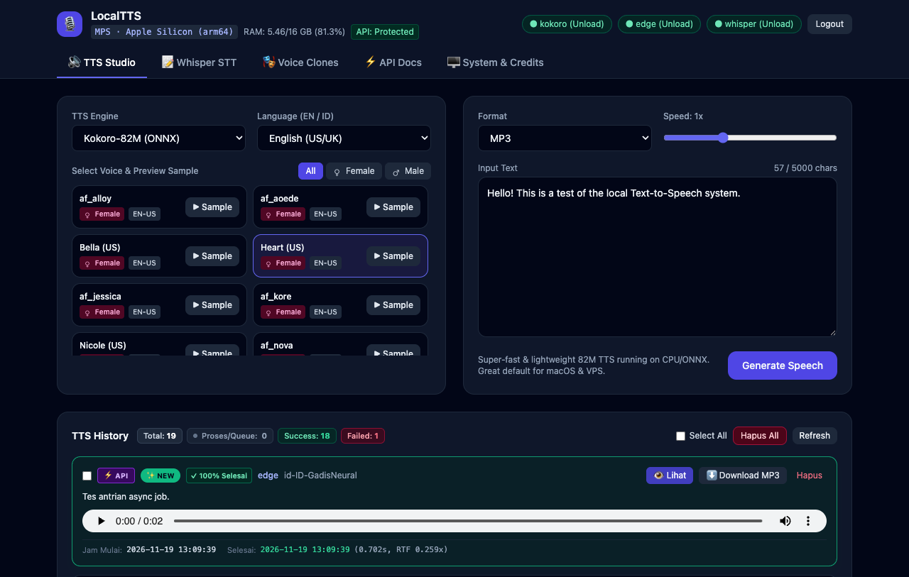
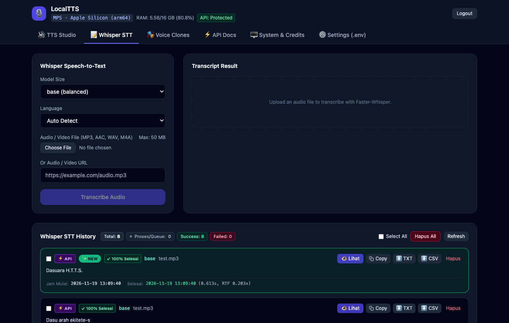
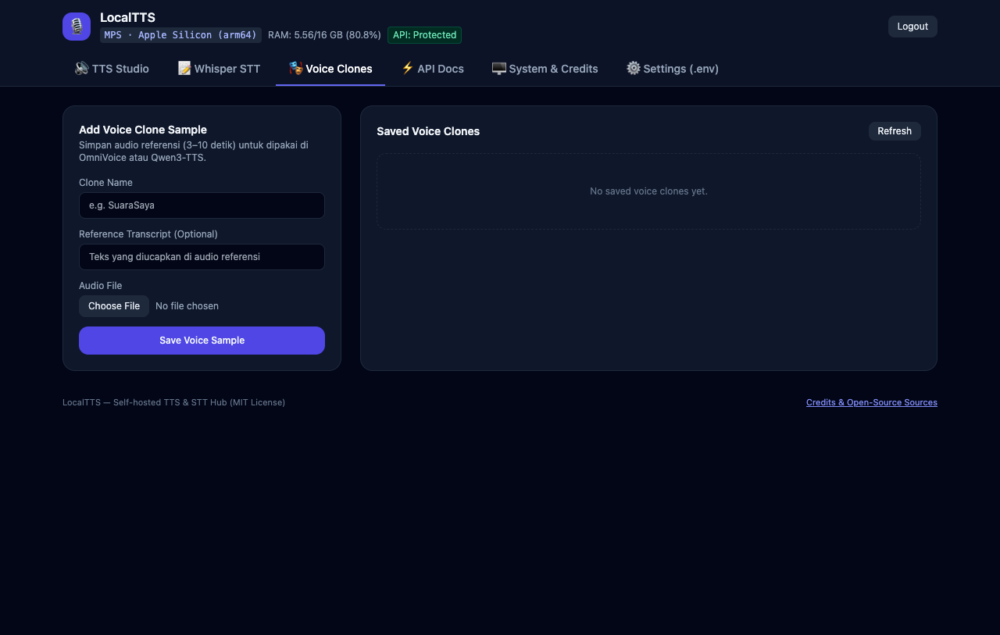
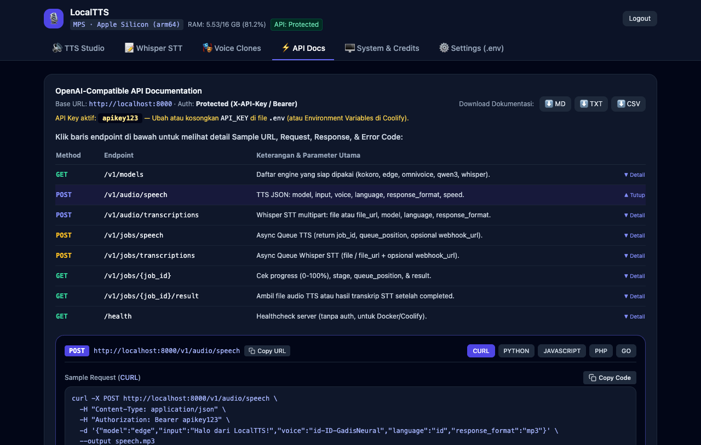
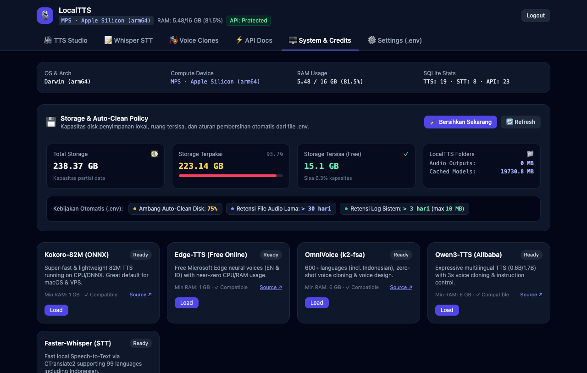
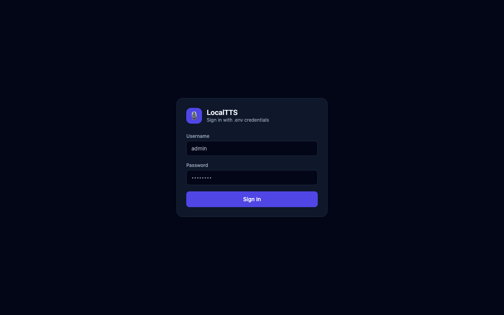

# LocalTTS

> **All-in-One Voice AI Hub:** Mengumpulkan berbagai aplikasi dan engine Text-to-Speech (TTS) serta Speech-to-Text (STT) open-source terbaik ke dalam **1 antarmuka web terpadu (Modern Web UI)** dan **1 standar OpenAI-compatible REST API** untuk mempermudah penggunaan dan integrasi.

[](LICENSE)
[](https://python.org)
[](https://fastapi.tiangolo.com)
[](https://docker.com)
[](https://coolify.io)
[](https://github.com/shedenk/localtts/releases)

---

## 💡 About LocalTTS (Tentang Proyek)

### Mengapa LocalTTS Dibuat?
Di era perkembangan AI saat ini, komunitas open-source telah melahirkan banyak sekali model suara yang luar biasa:
- **Kokoro-82M** yang sangat cepat di CPU biasa.
- **Edge-TTS** yang menyediakan suara Bahasa Indonesia dan Inggris yang sangat natural dengan beban RAM mendekati nol.
- **OmniVoice** dan **Qwen3-TTS** yang mampu melakukan *zero-shot voice cloning* (meniru suara hanya dari audio 3 detik).
- **Faster-Whisper** yang menjadi standar emas untuk transkripsi audio ke teks secara offline.

Namun, menjalankan dan mengintegrasikan model-model tersebut secara terpisah sangat merepotkan:
1. **Konflik Dependency:** Masing-masing engine memerlukan versi pustaka yang berbeda (misalnya perbedaan versi `transformers` dan `torch`).
2. **Tanpa Antarmuka Terpadu:** Pengguna harus menjalankan skrip Python atau CLI yang berbeda untuk tiap model.
3. **Format API Terpecah:** Tidak adanya format API standar yang kompatibel dengan aplikasi modern seperti OpenWebUI, n8n, LangChain, atau OpenAI SDK.

### Solusi LocalTTS
**LocalTTS menyatukan semuanya menjadi satu solusi yang rapi dan mudah:**
- **Satu Antarmuka Web (UI Studio):** Kelola teks, dengarkan preview sampel suara, filter suara berdasarkan gender/bahasa, unggah audio transkripsi, serta pantau riwayat dengan *live progress bar* dan estimasi waktu selesai.
- **Satu REST API Standar OpenAI:** Endpoint `/v1/audio/speech` dan `/v1/audio/transcriptions` siap pakai untuk menggantikan API OpenAI berbayar dengan model lokal tanpa mengubah kode aplikasi klien Anda.
- **Async Job Queue & Webhook:** Menyediakan antrean background `/v1/jobs/*` dengan nomor antrian, persentase progress, dan webhook callback otomatis saat proses selesai.
- **Manajemen Memori Pintar:** Fitur *lazy-loading* (hanya memuat model saat diminta) dan *auto-unload* (mengosongkan RAM/VRAM saat idle) sehingga server hemat daya dan tidak boros memori.
- **100% Self-Hosted & Privasi:** Semua proses dijalankan di server atau komputer Anda sendiri. Data teks dan rekaman suara Anda tidak pernah dikirim ke pihak ketiga.

---

## 📸 Tangkapan Layar UI/UX (Screenshots)

Berikut adalah tampilan antarmuka web LocalTTS yang modern, responsif, dan dirancang untuk kenyamanan pengguna:

### 1. 🔊 TTS Studio & Live History
> Pilih engine, filter gender & bahasa, preview sampel suara pendek, generate audio, dan pantau riwayat generasi secara realtime lengkap dengan badge asal pembuatan (`⚡ API` vs `🖥️ UI`), live progress bar, serta jam mulai dan perkiraan selesai.



---

### 2. 📝 Whisper Speech-to-Text
> Unggah file rekaman (MP3/WAV/AAC/M4A) atau masukkan link URL audio/video. Hasil transkripsi langsung tampil lengkap dengan timestamp segment dan tombol unduh format **TXT, CSV, atau SRT**.



---

### 3. 🎭 Voice Clones Library
> Simpan dan kelola sampel audio referensi (3–10 detik) untuk digunakan pada *zero-shot voice cloning* di OmniVoice atau Qwen3-TTS.



---

### 4. ⚡ OpenAI-Compatible API Docs
> Dokumentasi interaktif bawaan lengkap dengan contoh kode siap pakai dalam **cURL, Python, JavaScript / Node.js, PHP, dan Go**, terisi otomatis dengan `API_KEY` aktif.



---

### 5. 🖥️ System & Hardware Monitor
> Pantau penggunaan CPU, RAM, GPU (`CUDA` / `Apple MPS`), status kapasitas partisi disk (Total, Digunakan, Tersisa), live console System Logs, kebijakan auto-cleaning file audio lama & rotasi log, kelola pemuatan model ke RAM secara manual atau otomatis, tombol instalasi engine tambahan, serta penampil dokumen `README.md`.



---

### 6. 🔐 Halaman Login Dark Mode
> Autentikasi sesi aman berbasis token HMAC bertanda tangan waktu (*URL-safe timed serializer*) tanpa memerlukan konfigurasi database pengguna yang rumit.



---

### 7. ⚙️ Menu Pengaturan Environment (.env)
> Kelola semua konfigurasi `.env` secara visual langsung dari UI: nama aplikasi, port HTTP, proteksi login UI (username/password), API Key & generator kunci acak, compute device (`CUDA` / `MPS` / `CPU`), seleksi engine aktif (Kokoro, Edge, Whisper, OmniVoice, Qwen3), batas karakter/file, default webhook, hingga kebijakan auto-clean disk (75%) dan retensi file audio lama (30 hari). Perubahan langsung tersimpan ke file `.env` dan di-reload ke runtime server tanpa perlu akses terminal / SSH manual.

---

## 🚀 Fitur Unggulan

- **Multi-Engine dalam 1 Service:**
  - **[Kokoro-82M (`kokoro-onnx`)](https://github.com/thewh1teagle/kokoro-onnx):** Ringan, super cepat di CPU biasa / VPS, kualitas natural untuk Bahasa Inggris.
  - **[Edge-TTS (`rany2/edge-tts`)](https://github.com/rany2/edge-tts):** Suara neural gratis untuk Bahasa Indonesia (Gadis & Ardi) dan Inggris dengan beban CPU/RAM hampir nol.
  - **[OmniVoice (`k2-fsa/OmniVoice`)](https://github.com/k2-fsa/OmniVoice):** Suara ekspresif Indonesia & Inggris, *zero-shot voice cloning*, dan kontrol emosi / *voice design*.
  - **[Qwen3-TTS (`QwenLM/Qwen3-TTS`)](https://github.com/QwenLM/Qwen3-TTS):** TTS canggih dengan *voice cloning* 3 detik dan instruksi gaya berbicara.
  - **[Faster-Whisper](https://github.com/SYSTRAN/faster-whisper):** Transkripsi audio offline akurat dari file atau URL dengan ekspor format **TXT / CSV / SRT**.
- **Riwayat Terpadu (History Tracking):**
  - **Counter Header:** Total, Proses/Queue (*dengan indikator lampu berkedip*), Success, dan Failed.
  - **Badge Sumber:** Menampilkan apakah data dibuat melalui `⚡ API` atau `🖥️ UI`.
  - **Progress Realtime:** Menampilkan persentase progress dan *live progress bar* untuk tugas yang sedang antre/berjalan.
  - **Waktu Lengkap:** Menampilkan **Jam Mulai**, **Perkiraan Selesai** (saat antre), atau **Waktu Selesai Aktual** beserta durasi dan nilai RTF.
- **Sistem Notifikasi Pintar (Floating Toast):**
  - Notifikasi melayang saat proses dimulai di UI (*"Sedang diproses... Mohon tunggu."*).
  - Notifikasi saat proses selesai (*"Proses selesai! Audio berhasil dibuat."*).
  - Auto-polling yang mendeteksi saat semua antrean background selesai (*"Semua antrean selesai diproses!"*).
- **Keamanan Sederhana Berbasis `.env`:**
  - Proteksi Web UI via `AUTH_USERNAME` dan `AUTH_PASSWORD`.
  - Proteksi API via `API_KEY` (mendukung `Authorization: Bearer <KEY>` dan `X-API-Key: <KEY>`).
- **Menu Pengaturan Visual `.env`:**
  - Ubah seluruh parameter server, keamanan (username/password/API Key & random generator), hardware (`auto`/`cuda`/`mps`/`cpu`), seleksi engine aktif, batas kuota, webhook, serta kebijakan auto-clean disk langsung dari antarmuka Web UI tanpa perlu terminal / SSH / nano manual.
- **Penyimpanan Lokal Mandiri:**
  - Database **SQLite WAL** tersimpan rapi di `data/tts_local.db`.
  - File output audio disimpan di folder `data/outputs/`.

---

## 💻 Spesifikasi Sistem

| Mode | CPU | RAM | Storage | GPU |
| :--- | :--- | :--- | :--- | :--- |
| **Mode Standar (Default)**<br>*(Edge-TTS, Kokoro-82M, Faster-Whisper `tiny`/`base`)* | 1–2 vCPU | **1–2 GB** | 2–3 GB | Tidak perlu (CPU Only) |
| **Mode Lengkap (`--all` / Install dari UI)**<br>*(+ OmniVoice & Qwen3-TTS)* | 4+ vCPU / Apple Silicon | **8–16 GB** | 15–25 GB | Opsional (NVIDIA VRAM ≥ 6–8 GB atau Apple MPS) |

> **Hemat RAM:** Model dimuat secara *lazy-load* saat pertama kali dipanggil dan otomatis dikeluarkan dari RAM setelah tidak digunakan selama waktu tertentu (`IDLE_UNLOAD_SECONDS=300`).

---

## 🛠️ Panduan Instalasi & Menjalankan

### 1. macOS (Apple Silicon / Intel)
> Disarankan menjalankan native agar PyTorch dapat menggunakan akselerasi **Apple Silicon GPU (MPS)**.

```bash
git clone https://github.com/shedenk/localtts.git
cd localtts
chmod +x scripts/setup-mac.sh scripts/run-mac.sh

# Install mode standar (Kokoro, Edge-TTS, Faster-Whisper)
./scripts/setup-mac.sh

# (Opsional) Install semua engine sekaligus:
# ./scripts/setup-mac.sh --all

# Jalankan server
./scripts/run-mac.sh
```
Buka browser di `http://localhost:8000` (Login default: `admin` / `changeme123`).

---

### 2. Linux (Ubuntu / Debian / Fedora)

```bash
git clone https://github.com/shedenk/localtts.git
cd localtts
chmod +x scripts/setup-linux.sh

# Install mode standar
./scripts/setup-linux.sh

# Jalankan server
.venv/bin/uvicorn app.main:app --host 0.0.0.0 --port 8000
```

---

### 3. Windows (PowerShell)
> Pastikan `ffmpeg` sudah terpasang (`winget install Gyan.FFmpeg`).

```powershell
git clone https://github.com/shedenk/localtts.git
cd localtts

# Install mode standar
.\scripts\setup-win.ps1

# Jalankan server
.\.venv\Scripts\uvicorn.exe app.main:app --host 0.0.0.0 --port 8000
```

---

### 4. Docker & Docker Compose

```bash
git clone https://github.com/shedenk/localtts.git
cd localtts
cp .env.example .env

# Jalankan container
docker compose up -d --build
```

---

### 5. Deploy di Panel Cloud (Coolify, Dokploy, Portainer, EasyPanel)

#### **Coolify**
1. Pilih **New Resource → Public/Private Repository** → masukkan URL repository ini.
2. Pilih **Build Pack: Docker Compose**, lalu tentukan **Docker Compose Location** ke `docker-compose.coolify.yaml`.
3. Di tab **Environment Variables**, isi konfigurasi:
   - `AUTH_USERNAME=admin`
   - `AUTH_PASSWORD=password_pilihan_anda`
   - `SESSION_SECRET=kunci_rahasia_acak_panjang`
   - `API_KEY=` *(kosongkan jika API ingin terbuka, atau isi secret key)*
   - `INSTALL_ALL_ENGINES=false` *(default ringan; set `true` jika server memiliki RAM ≥ 8 GB / GPU)*
4. Pastikan volume persistent terpasang untuk `/app/data` dan `/app/models` (sudah otomatis ada di file compose).
5. Klik **Deploy**.

---

## ⚙️ Konfigurasi Environment (`.env`)

| Variable | Default | Keterangan |
| :--- | :--- | :--- |
| `PORT` | `8000` | Port server HTTP |
| `AUTH_USERNAME` | `admin` | Username login UI (kosongkan jika tanpa login) |
| `AUTH_PASSWORD` | `changeme123` | Password login UI (kosongkan jika tanpa login) |
| `SESSION_SECRET` | `...` | Kunci enkripsi cookie session UI |
| `API_KEY` | *(kosong)* | Kunci autentikasi API `/v1/*` (kosong = publik tanpa header) |
| `API_KEY_HEADER` | `X-API-Key` | Header kustom selain `Authorization: Bearer` |
| `DEVICE` | `auto` | `auto` \| `cuda` \| `mps` \| `cpu` |
| `ENABLED_ENGINES` | `kokoro,edge,whisper,omnivoice,qwen3` | Daftar engine yang aktif |
| `IDLE_UNLOAD_SECONDS` | `300` | Detik idle sebelum model otomatis di-unload dari RAM (`0` = nonaktif) |
| `TTS_MAX_CHARS` | `5000` | Batas karakter teks TTS per request (`0` = tanpa batas) |
| `STT_MAX_FILE_MB` | `50` | Batas ukuran file audio/video STT dalam MB (`0` = tanpa batas) |
| `WEBHOOK_URL` | *(kosong)* | Default URL webhook saat async job selesai |
| `ALLOW_LOCAL_URLS` | `true` | Izinkan alamat lokal `127.0.0.1` pada webhook & URL audio |
| `AUTO_CLEAN_DISK_PERCENT` | `75` | Ambang batas penggunaan disk (%) untuk memicu auto-clean berkala |
| `AUTO_CLEAN_RETENTION_DAYS` | `30` | Hapus file audio output lama yang berumur > N hari |
| `LOG_RETENTION_DAYS` | `3` | Retensi log sistem (hari) sebelum otomatis dibersihkan |
| `LOG_MAX_MB` | `10` | Batas maksimal ukuran file log dalam MB sebelum dirotasi |

---

## 📡 OpenAI-Compatible API

### 1. Text-to-Speech (`POST /v1/audio/speech`)
```bash
curl -X POST http://localhost:8000/v1/audio/speech \
  -H "Content-Type: application/json" \
  -H "Authorization: Bearer apikey123" \
  -d '{
    "model": "edge",
    "input": "Selamat pagi dunia, hari ini adalah hari paling indah, selamat beraktifitas.",
    "voice": "id-ID-GadisNeural",
    "language": "id",
    "response_format": "mp3"
  }' \
  --output selamat_pagi.mp3
```

### 2. Speech-to-Text Whisper (`POST /v1/audio/transcriptions`)
```bash
curl -X POST http://localhost:8000/v1/audio/transcriptions \
  -H "Authorization: Bearer apikey123" \
  -F "file=@audio.mp3" \
  -F "model=base" \
  -F "language=id" \
  -F "response_format=json"
```

### 3. Async Job Queue (`POST /v1/jobs/speech`)
```bash
# 1. Masukkan job ke antrean
curl -X POST http://localhost:8000/v1/jobs/speech \
  -H "Content-Type: application/json" \
  -H "Authorization: Bearer apikey123" \
  -d '{"model":"edge","input":"Teks panjang...","voice":"id-ID-GadisNeural","webhook_url":"https://webhook.site/id"}'

# 2. Cek progress & status
curl http://localhost:8000/v1/jobs/JOB_ID -H "Authorization: Bearer apikey123"

# 3. Unduh hasil setelah selesai
curl http://localhost:8000/v1/jobs/JOB_ID/result -H "Authorization: Bearer apikey123" --output hasil.mp3
```

---

## 📦 Rilis Paket (Package Release)

LocalTTS dirilis sebagai paket Python mandiri yang dapat di-build dan di-install menggunakan `pip` atau `uv`:

### Build Distribusi Paket
```bash
# Menggunakan uv (sangat cepat):
uv build

# Menghasilkan:
# dist/localtts-0.1.0-py3-none-any.whl (Wheel)
# dist/localtts-0.1.0.tar.gz (Source Distribution)
```

### Instalasi dari Wheel
```bash
pip install dist/localtts-0.1.0-py3-none-any.whl
```

### Versi Rilis
- **Tag:** `v0.1.0`
- **Changelog:**
  - Multi-engine TTS (Kokoro ONNX, Edge-TTS, OmniVoice, Qwen3-TTS) & Faster-Whisper STT.
  - OpenAI-compatible REST API endpoints (`/v1/audio/speech`, `/v1/audio/transcriptions`).
  - Async Job Queue worker dengan progress tracking dan webhook callback.
  - UI Studio modern dengan Dark Mode, preview audio sample, dan tab manajemen hardware.
  - Riwayat lengkap: indikator sumber (`⚡ API` vs `🖥️ UI`), live progress bar, jam mulai & perkiraan selesai, serta counter status header (Total, Queue, Success, Failed).
  - Floating toast notifications untuk status pemrosesan dan penyelesaian antrean.

---

## 📄 Lisensi & Legalitas

- **Lisensi Kode:** Seluruh kode aplikasi LocalTTS dirilis di bawah [MIT License](LICENSE).
- **Merek Dagang:** LocalTTS adalah proyek independen open-source dan tidak berafiliasi dengan OpenAI, Microsoft, atau Alibaba.
- **Engine Suara:** Seluruh engine yang digunakan mematuhi lisensi masing-masing (Kokoro-82M Apache-2.0, Faster-Whisper MIT, OmniVoice Apache-2.0, Qwen3-TTS Apache-2.0). Khusus `edge-tts` menggunakan layanan online publik Microsoft Edge — gunakan untuk pengujian dan kebutuhan non-komersial. Untuk kebutuhan produksi skala penuh, gunakan engine offline lokal (`kokoro`, `omnivoice`, atau `qwen3`).
- **Voice Cloning:** Fitur peniruan suara (*voice cloning*) wajib digunakan secara etis hanya dengan suara pribadi atau atas izin tertulis dari pemilik suara.
